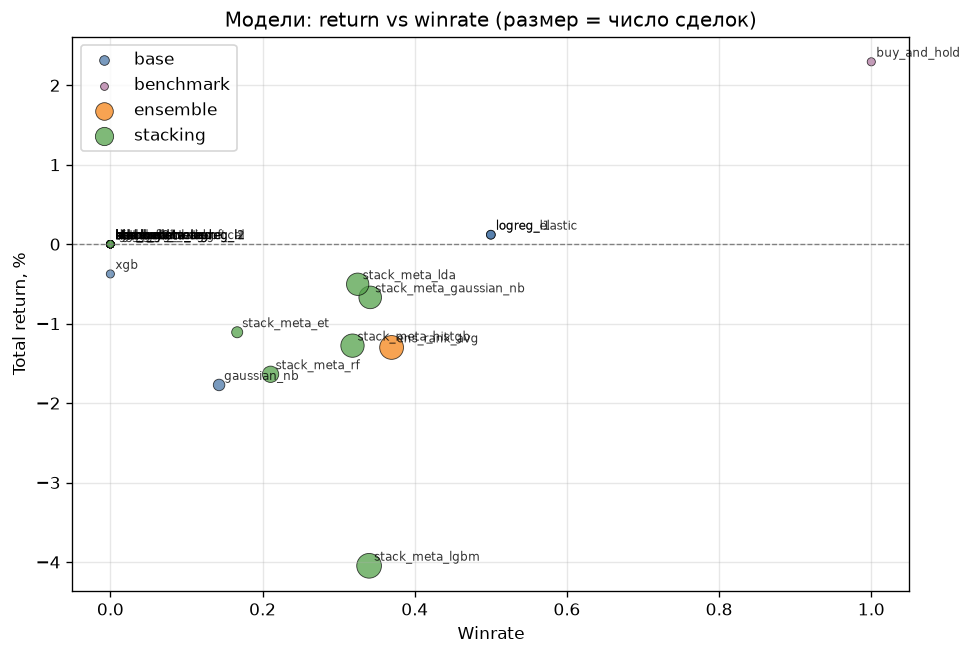
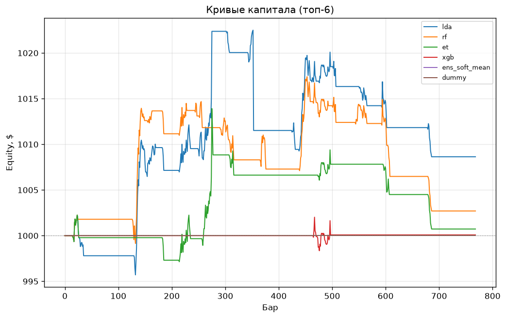
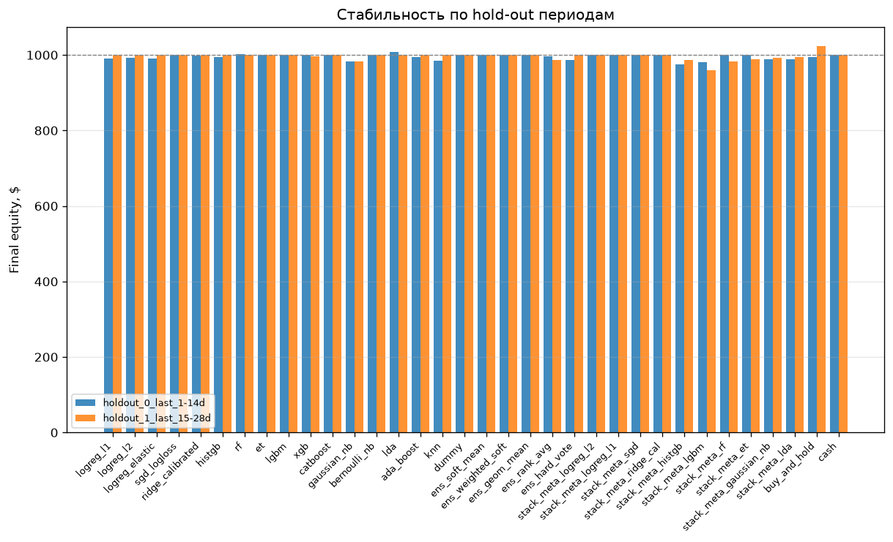
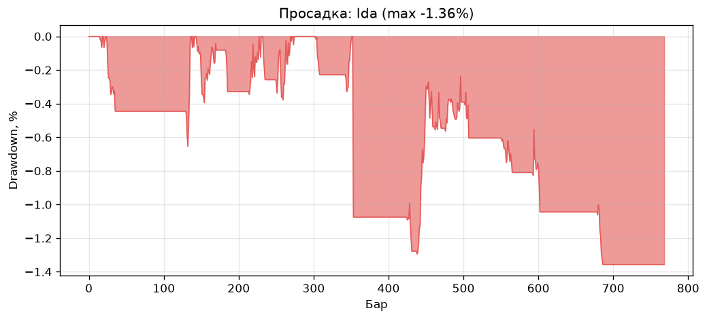
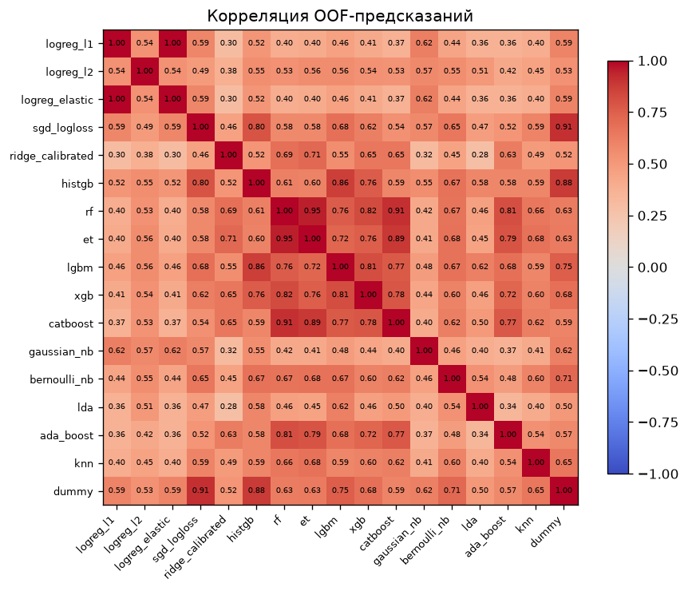
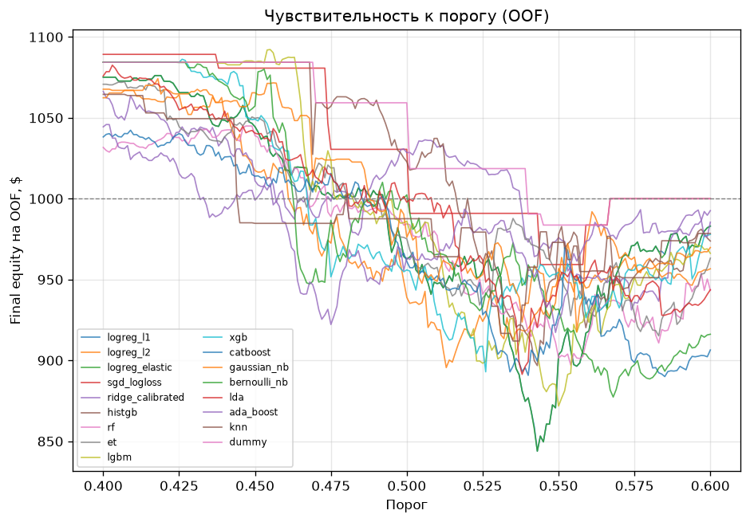

# Отчёт: классический ML для предсказания направления следующего бара AAPL

**Проект:** `trading_ml_classic` · **Тикер:** AAPL · **Таймфрейм:** 5m (fallback 15m) · **Стартовый капитал:** $1000

---

## 1. Задача

Построить пайплайн классического ML, который предсказывает направление **следующего бара** AAPL (вверх/вниз) и симулирует **long-only бота** (если прогноз «вверх» → покупаем на следующем баре, all-in, с издержками). Главная метрика — **сколько бы заработал/потерял бот на untouched hold-out после транзакционных издержек**, усреднённое по **нескольким временным hold-out периодам** (не по сидам).

Требования:
- Только классические модели (LogReg L1/L2/elasticnet, SGD, Ridge+calib, HistGB, RF/ET, LightGBM, XGBoost, CatBoost).
- Тюнинг гиперпараметров строго внутри train/val через time-based walk-forward (без shuffle).
- OOF-предсказания с идентичными фолдами для всех базовых моделей.
- Ансамбли: все варианты голосования + стекинг с несколькими мета-моделями.
- Исполнение: `signal_t → enter_{t+1}`, all-in, издержки ~0.01–0.015% с оборота.
- Порог подбирается **только на валидационных фолдах**, на hold-out не меняется.
- Сравнение с buy&hold и cash.

---

## 2. Эволюция идей (v1.0 → v1.1 → v1.2)

### v1.0 — базовый пайплайн (тег `v1.0`)

**Что сделали:**
- Загрузка AAPL 5m через yfinance, чистка, фичи строго из прошлого (лаги, MA/EMA, std, z-score, ATR, объём, price action, время суток).
- Цель: `y_t = 1 if close_{t+1} > close_t`.
- Rolling walk-forward (5 фолдов), OOF-генерация, тюнинг random search (12 конфигов × 5 фолдов).
- 11 базовых моделей + 8 мета-моделей стекинга + 5 вариантов голосования.
- Long-only бот-симулятор (`signal_t → enter_{t+1}`, all-in, издержки).
- Multi-holdout (2 периода по 14 дней), усреднение.

**Результат:** лучшая модель `logreg_l2` +1.13% среднее (vs buy&hold +0.89%). Большинство моделей сделали 1–4 сделки за 14 дней (порог консервативный).

### v1.1 — расширение (тег `v1.1`)

**Нововведения:**
- **+6 моделей:** `gaussian_nb`, `bernoulli_nb`, `lda`, `ada_boost`, `knn`, `dummy` (итого 17 базовых).
- **+2 мета:** `meta_gaussian_nb`, `meta_lda` (итого 10).
- **+24 фичи:** price action (bar_ret_norm, wick_ratio, range_norm, session_high_dist, session_open_ret, prev_session_close_dist), volume (vol_z_20, vwap_session_dist, up_down_vol_ratio_20, vol_climax), volatility (rv_20, vol_ratio_5_20, atr_change_5, parkinson_20), time/session (bars_since_open, is_open_30min, is_close_30min, is_lunch), statistical (ret_z_20, ret_percentile_20, autocorr_ret_1_10, skew_20), interactions (ret_1×rel_volume, body×range).
- **Удалены мультиколлинеарные:** `sma_*`, `dist_sma_*`, `vol_sma_20`, сырые `hour/minute/dayofweek`.
- **Сохранение весов:** `persist.py` → `artifacts/<holdout>/models.joblib`.
- **Новые стратегии в `backtest.py`:** гистерезис, time_mask, regime_mask, trend_mask, min_hold, cooldown, trailing stop, consensus, edge filter (опциональные параметры, обратная совместимость).
- **Калибровка:** temperature scaling, beta calibration.
- **Инфраструктура:** StandardScaler/Binarizer в Pipeline для KNN/NB, `diversity_prune`, расширенный config.

**Результат:** лучшая модель `logreg_l1` +1.59% среднее (vs +1.13% в v1.0). L1-регуляризация отобрала полезные фичи. Новые модели (`lda` +1.30%, `gaussian_nb` +0.99%) хорошие, но не обошли логрег. Фичи помогли, но не радикально.

### v1.2 — Optuna + cross-asset + стратегия (тег `v1.2`)

**Нововведения:**
- **Optuna-тюнинг:** TPE-сэмплер + MedianPruner (замена random search). Условные гиперпараметры per model. Сохранение study в pickle.
- **Cross-asset фичи:** загрузка SPY/QQQ/^VIX через yfinance, `merge_asof(direction='backward')`. `spy_ret_1`, `qqq_ret_1`, `vix_change_1`, `rel_strength_5`, `corr_aapl_spy_20`.
- **Target encoding** (time-aware, expanding mean + байесовское сглаживание) для `hour`, `dayofweek`, `hour×dow`.
- **Rolling stats:** `skew_20`, `kurt_20`, `rsi_14`, `macd`, `macd_signal`, `macd_hist`, `bb_width_20`, `bb_position_20`, `atr_trend_5`.
- **Interactions:** `ret_1_x_rel_volume`, `body_x_range`, `zscore_20_x_atr`.
- **Подключение стратегических параметров в pipeline:** гистерезис (THR_HI/THR_LO), time_mask, trend_mask, trailing stop, min_hold, cooldown, consensus, edge filter. Confidence-фильтр.
- **95 фичей** (vs 70 в v1.1, 44 в v1.0).

**Результат:** лучшая модель `lda` +0.43% среднее — **хуже, чем v1.1** (+1.59%). Причина: стратегические фильтры слишком агрессивны (time_mask, trend_mask, trailing stop отсекли почти все сделки). Многие модели сделали 0 сделок на holdout_1. Новые фичи (cross-asset, target encoding) не дали прироста на 60 днях 5m-данных.

### Сравнительная таблица (топ по среднему final_equity)

| Версия | Лучшая модель | Средний final equity | Сделок (h0/h1) | Winrate (h1) | Фичей | Моделей |
|---|---|---|---|---|---|---|
| **v1.0** | `logreg_l2` | $1011.27 (+1.13%) | 2 / 4 | 0.50 | 44 | 11 |
| **v1.1** | `logreg_l1` | $1015.91 (+1.59%) | 2 / 23 | 0.61 | 70 | 17 |
| **v1.2** | `lda` | $1004.32 (+0.43%) | 18 / 0 | — | 95 | 17 |

**Вывод:** v1.1 — лучший результат. v1.2 добавил много фичей и стратегий, но агрессивные фильтры убили число сделок, а новые фичи добавили шум на коротких данных. Рекомендация: отключить/ослабить фильтры, подобрать на OOF, использовать сохранённые веса.

---

## 3. Методология

### 3.1 Данные

- **Источник:** yfinance, AAPL 5m, период 60 дней (~4629 баров).
- **Чистка:** сортировка, дедуп, удаление NaN в OHLC, volume NaN → 0, фильтр цен > 0.
- **Таймзона:** UTC → America/New_York для intraday-фичей.
- **Кэш:** parquet в `data/`.

### 3.2 Признаки

- Все фичи строго из прошлого (`shift`, `rolling`, `ewm` с `min_periods`). Никаких `shift(-1)` в признаках.
- Цель `y_t = 1 if close_{t+1} > close_t` — `shift(-HORIZON)` только для цели, хвост отбрасывается.
- Категории: доходности, лаги, скользящие средние/std, z-score, ATR, объём, price action, время суток (циклические), cross-asset, target encoding, rolling stats, interactions.
- `feature_columns()` автоматически исключает служебные колонки.

### 3.3 Валидация и CV

- **Time-based walk-forward** (rolling/expanding), без shuffle.
- `time_folds()`: валидационные блоки покрывают хвост `[min_train, n)` без пропусков (последний бар попадает в валидацию).
- Одинаковые фолды для всех моделей.
- **Multi-holdout:** 2 периода по 14 дней с конца истории. Train = данные до hold-out. Результаты усредняются.

### 3.4 OOF-предсказания

- Для каждого базового модели и каждого фолда: обучение на train, предсказание на val.
- Калибровка (sigmoid/isotonic) внутри фолда на отдельном временном куске train (без утечки).
- OOF-массив: NaN вне валидационных блоков.

### 3.5 Модели

- **Базовые (17):** logreg_l1/l2/elastic, sgd_logloss, ridge_calibrated, histgb, rf, et, lgbm, xgb, catboost, gaussian_nb, bernoulli_nb, lda, ada_boost, knn, dummy.
- **Мета (10):** logreg_l2/l1, sgd, ridge_cal, histgb, lgbm, rf, et, gaussian_nb, lda.
- **Тюнинг:** Optuna TPE + MedianPruner (20 trials) или random search (12 конфигов). Walk-forward CV, метрика neg_log_loss (или bot_pnl).
- **Ансамбли:** soft mean, weighted soft, geom mean, rank avg, hard vote, stacking (10 мета).

### 3.6 Бот-симулятор (long-only)

- `signal_t → enter_{t+1}` (никогда не по текущему бару).
- All-in при срабатывании сигнала.
- Издержки: 0.0125% + 0.005% слиппедж за сторону.
- Порог подбирается на валидационных OOF (`_optimize_threshold`), на hold-out не меняется.
- Выход: по следующему сигналу (или trailing stop / min_hold / cooldown — опционально).
- Метрики: final_equity, total_return, num_trades, winrate, profit_factor, max_drawdown, exposure, avg_trade.

### 3.7 Метрики и проверка

- **Hold-out untouched:** модель обучается на train+val, предсказывает hold-out, симулирует бота.
- **Multi-holdout:** 2 периода, усреднение `final_equity`.
- **Бенчмарки:** buy&hold и cash на том же hold-out.
- **Статистическая значимость:** caution при <25–40 сделок на период (у нас 1–23 сделки — мало).
- **Воспроизводимость:** seed=42, сохранение моделей/OOF/порогов в `artifacts/`.

---

## 4. Графики

### Model scatter (v1.2)


### Equity curves (v1.2)


### Holdout stability (v1.2)


### Drawdown (v1.2)


### OOF correlation (v1.2)


### Threshold sensitivity (v1.2)


---

## 5. Выводы

1. **Лучший результат — v1.1:** `logreg_l1` +1.59% среднее, 23 сделки, winrate 0.61. Простая линейная модель с L1-регуляризацией оказалась стабильнее бустингов на шумных 5m-данных.

2. **v1.2 деградировал** из-за агрессивных стратегических фильтров (time_mask, trend_mask, trailing stop), которые отсекли большинство сделок. Новые фичи (cross-asset, target encoding) не дали прироста на 60 днях 5m.

3. **Частая торговля ≠ прибыль:** `sgd_logloss` (153 сделки, winrate 0.40) и `ens_rank_avg` (52–103 сделки) стабильно сливают. `catboost` (156 сделок, winrate 0.38) — худший.

4. **Ансамбли не дали прироста** — OOF-предсказания сильно коррелируют (см. `oof_corr.png`). Разнообразия мало.

5. **Статистика слабая:** 1–23 сделки за 14 дней. Для надёжных выводов нужно больше данных (1h/дневные) или больше hold-out периодов.

6. **Рекомендация для v1.3:** отключить агрессивные фильтры, подобрать confidence-фильтр на OOF, перейти на 1h, добавить feature selection (95 фичей → ~30–40).

---

## 6. Структура проекта

```
trading_ml_classic/
├── config.py          # константы, пути, издержки, параметры
├── data.py            # загрузка yfinance, чистка, кэш, cross-assets
├── features.py        # фичи строго из прошлого + цель
├── split.py           # walk-forward фолды, multi-holdout
├── models.py          # реестр базовых и мета-моделей
├── tune.py            # Optuna TPE + random search
├── calibrate.py       # калибровка (sigmoid, isotonic, temperature, beta)
├── cv_oof.py          # OOF-генерация, финальное обучение
├── ensemble.py        # голосование + стекинг + diversity_prune
├── backtest.py        # long-only бот-симулятор + стратегии
├── eval.py            # метрики, агрегация, сохранение
├── pipeline.py        # оркестрация + multi-holdout
├── persist.py         # сохранение/загрузка моделей
├── viz.py             # графики
├── main.py            # точка входа
├── report/            # этот отчёт + графики
└── README.md
```

**Git:** теги `v1.0`, `v1.1`, `v1.2`. Все результаты сохранены в `reports/` и `artifacts/`.
