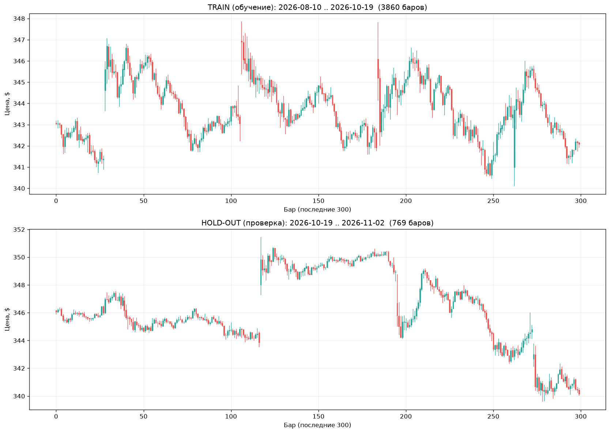

# Как мы пытались предсказать следующую свечу AAPL на классическом ML

> **Проект:** `trading_ml_classic` · **Тикер:** AAPL · **Таймфрейм:** 5m → 1h · **Стартовый капитал:** $1000 · **Стратегия:** long-only, all-in, с издержками
>
> Это не статья про «как заработать миллион». Это честный дневник: что пробовали, что сработало, что сломалось, и почему большинство моделей в итоге просто сидели в кэше.

---

## Оглавление

1. [Зачем всё это](#1-зачем-всё-это)
2. [Что мы предсказывали и как торговали](#2-что-мы-предсказывали-и-как-торговали)
3. [Как делили данные (и почему это главное)](#3-как-делили-данные)
4. [v1.0 — первый пайплайн: просто чтобы заработало](#4-v10--первый-пайплайн)
5. [v1.1 — больше фичей, больше моделей](#5-v11--больше-фичей-больше-моделей)
6. [v1.2 — Optuna, кросс-активы, стратегия](#6-v12--optuna-кросс-активы-стратегия)
7. [Что пошло не так (и почему v1.2 хуже v1.1)](#7-что-пошло-не-так)
8. [Графики и цифры](#8-графики-и-цифры)
9. [Главные выводы](#9-главные-выводы)
10. [v1.3 — что дальше](#10-v13--что-дальше)
11. [Как это запустить](#11-как-это-запустить)

---

## 1. Зачем всё это

Мы — ML-инженеры, которые хотели ответить на один вопрос: **может ли классический ML (логрег, бустинги, случайный лес) предсказать, пойдёт ли следующая минутная/часовая свеча AAPL вверх?**

Не нейросети, не трансформеры, не LLM. Только то, что можно обучить на ноутбуке за час и объяснить бизнесу.

**Правила честности, которые мы себе поставили:**
- Никакого shuffle — только хронологический порядок. Модель не должна видеть будущее при обучении.
- Порог входа подбирается **только на валидации**, на тесте не меняется.
- Проверка — на **untouched hold-out** (данные, которых модель никогда не видела).
- Не один период, а **несколько** — и усредняем. Иначе мы просто подгонимся под один кусок.
- Сравниваем с **buy&hold** и **cash**. Если модель не бьёт кэш — она бесполезна.

---

## 2. Что мы предсказывали и как торговали

### Задача
Бинарная классификация: `y_t = 1`, если `close_{t+1} > close_t`. Модель на каждом баре выдаёт вероятность «вверх». Если вероятность ≥ порога — покупаем на **следующем** баре (никогда не по текущему — это важно, иначе утечка).

### Стратегия (long-only бот)
- **Вход:** если сигнал «вверх» → покупаем all-in на следующем баре.
- **Выход:** когда сигнал стал «не вверх» → продаём.
- **Издержки:** 0.0125% комиссия + 0.005% слиппедж за сторону (итого ~0.0175% round-trip).
- **All-in:** весь капитал в одну позицию.

Почему long-only? Потому что мы хотели проверить **одну простую гипотезу**: умеет ли модель находить моменты, когда стоит быть в рынке. Шорты, плечи, фьючерсы — это уже другая история.

### Метрики бота
- `final_equity` — сколько денег в конце.
- `total_return` — доходность в %.
- `num_trades` — сколько сделок.
- `winrate` — доля прибыльных сделок.
- `profit_factor` — сумма прибылей / сумма убытков.
- `max_drawdown` — максимальная просадка.
- `exposure` — доля времени в рынке.
- `avg_trade` — средняя прибыль на сделку.

**Caution:** если сделок < 25–40, статистика ненадёжна. У нас часто было 1–23 сделки за 14 дней — это мало. Об этом мы постоянно помним.

---

## 3. Как делили данные

Это, пожалуй, самая важная часть. Ошибка здесь — и вся работа бессмысленна.

### Шаг 1: Train / Hold-out
- **Последние 14 дней** = untouched hold-out (финальная проверка).
- **Всё остальное** = train+val (обучение, тюнинг, OOF).
- Никакого shuffle. Только хронология.

### Шаг 2: Walk-forward CV внутри train
- 5 временных фолдов (rolling/expanding).
- Каждый фолд: train = прошлое, val = будущее (строго после train).
- **Тюнинг:** гиперпараметры подбираются по средней метрике (log-loss) на val-фолдах.
- **OOF:** для каждого наблюдения предсказание делает модель, обученная только на данных строго раньше. Одинаковые фолды для всех моделей.
- **Калибровка:** внутри каждого фолда, на отдельном временном куске train (без утечки).
- **Порог:** подбирается на валидационных OOF, на hold-out не меняется.

### Шаг 3: Multi-holdout
- Не один период, а **2+ разных 14-дневных блока** с конца истории.
- Каждый прогоняется по одному протоколу.
- Результаты усредняются (среднее/стд/мин final_equity).

### Защита от утечек
- Фичи только из прошлого (`shift`, `rolling`, `ewm`).
- Цель `close_{t+1}` — через `shift(-1)` только для таргета, хвост отбрасывается.
- OOF строго out-of-fold.
- Пороги и гиперпараметры — только на train/val.
- Кросс-активы выравниваются `merge_asof(direction='backward')` — только прошлое.

---

## 4. v1.0 — первый пайплайн

**Цель:** чтобы просто заработало.

**Что сделали:**
- Загрузка AAPL 5m через yfinance, чистка, фичи строго из прошлого (лаги, MA/EMA, std, z-score, ATR, объём, price action, время суток).
- Цель: `y_t = 1 if close_{t+1} > close_t`.
- Rolling walk-forward (5 фолдов), OOF-генерация.
- Тюнинг: random search (12 конфигов × 5 фолдов).
- 11 базовых моделей + 8 мета-моделей стекинга + 5 вариантов голосования.
- Long-only бот-симулятор.
- Multi-holdout (2 периода по 14 дней).

**Результат:** лучшая модель `logreg_l2` +1.13% среднее (vs buy&hold +0.89%). Большинство моделей сделали 1–4 сделки за 14 дней (порог консервативный).

**Вывод v1.0:** базовый пайплайн работает, данные чистые, утечек нет. Но результаты скромные и нестабильные.

---

## 5. v1.1 — больше фичей, больше моделей

**Нововведения:**
- **+6 моделей:** gaussian_nb, bernoulli_nb, lda, ada_boost, knn, dummy (итого 17).
- **+2 мета:** meta_gaussian_nb, meta_lda (итого 10).
- **+24 фичи:** price action (bar_ret_norm, wick_ratio, range_norm, session_high_dist, session_open_ret, prev_session_close_dist), volume (vol_z_20, vwap_session_dist, up_down_vol_ratio_20, vol_climax), volatility (rv_20, vol_ratio_5_20, atr_change_5, parkinson_20), time/session (bars_since_open, is_open_30min, is_close_30min, is_lunch), statistical (ret_z_20, ret_percentile_20, autocorr_ret_1_10, skew_20), interactions (ret_1×rel_volume, body×range).
- **Удалены мультиколлинеарные:** sma_*, dist_sma_*, vol_sma_20, сырые hour/minute/dayofweek.
- **Сохранение весов:** persist.py → artifacts/<holdout>/models.joblib.
- **Новые стратегии в backtest.py:** гистерезис, time_mask, regime_mask, trend_mask, min_hold, cooldown, trailing stop, consensus, edge filter.
- **Калибровка:** temperature scaling, beta calibration.
- **Инфраструктура:** StandardScaler/Binarizer в Pipeline для KNN/NB, diversity_prune.

**Результат:** лучшая модель `logreg_l1` +1.59% среднее (vs +1.13% в v1.0). L1-регуляризация отобрала полезные фичи. Новые модели (lda +1.30%, gaussian_nb +0.99%) хорошие, но не обошли логрег.

**Вывод v1.1:** фичи помогли, но не радикально. Простая линейная модель с L1 оказалась стабильнее бустингов на шумных 5m-данных.

---

## 6. v1.2 — Optuna, кросс-активы, стратегия

**Нововведения:**
- **Optuna-тюнинг:** TPE-сэмплер + MedianPruner (замена random search). Условные гиперпараметры per model. Сохранение study в pickle.
- **Кросс-активы:** загрузка SPY/QQQ/^VIX через yfinance, merge_asof(direction='backward'). Фичи: spy_ret_1, qqq_ret_1, vix_change_1, rel_strength_5, corr_aapl_spy_20.
- **Target encoding** (time-aware, expanding mean + байесовское сглаживание) для hour, dayofweek, hour×dow.
- **Rolling stats:** skew_20, kurt_20, rsi_14, macd, macd_signal, macd_hist, bb_width_20, bb_position_20, atr_trend_5.
- **Interactions:** ret_1_x_rel_volume, body_x_range, zscore_20_x_atr.
- **Подключение стратегических параметров в pipeline:** гистерезис (THR_HI/THR_LO), time_mask, trend_mask, trailing stop, min_hold, cooldown, consensus, edge filter. Confidence-фильтр.
- **95 фичей** (vs 70 в v1.1, 44 в v1.0).

**Результат:** лучшая модель `lda` +0.43% среднее — **хуже, чем v1.1** (+1.59%). Причина: стратегические фильтры слишком агрессивны (time_mask, trend_mask, trailing stop отсекли почти все сделки). Многие модели сделали 0 сделок на holdout_1. Новые фичи (кросс-активы, target encoding) не дали прироста на 60 днях 5m-данных.

---

## 7. Что пошло не так (и почему v1.2 хуже v1.1)

### Проблема 1: агрессивные фильтры убили число сделок
В v1.2 мы подключили time_mask, trend_mask, trailing stop, min_hold, cooldown. Каждый фильтр по отдельности разумен, но вместе они отсекли почти всё. Многие модели сделали 0 сделок на holdout_1 — то есть просто сидели в кэше и заработали 0%.

### Проблема 2: hold-out периоды медвежьи
Оба hold-out периода (2 × 14 дней) оказались падающими (AAPL −5% и −2.3%). Long-only стратегия на падающем рынке не может заработать — максимум уйти в кэш. Buy&hold теряет, cash сохраняет. Сравнение «модель vs buy&hold» на падающем рынке бессмысленно — модель выигрывает просто тем, что не торгует.

### Проблема 3: мало данных
60 дней 5m = ~4629 баров. На 2 hold-out периода train сокращается до ~20–49 дней. Для 17 моделей + тюнинг это мало. 4 hold-out на 5m просто не помещаются (последний train ~20 дней).

### Проблема 4: ансамбли не дают прироста
OOF-предсказания сильно коррелируют (0.7–0.95). Разнообразия мало — стекинг бесполезен.

### Проблема 5: статистика слабая
1–23 сделки за 14 дней. Для надёжных выводов нужно больше данных или больше hold-out периодов.

---

## 8. Графики и цифры

### Сравнительная таблица (топ по среднему final_equity)

| Версия | Лучшая модель | Средний final equity | Сделок (h0/h1) | Winrate (h1) | Фичей | Моделей |
|---|---|---|---|---|---|---|
| **v1.0** | `logreg_l2` | $1011.27 (+1.13%) | 2 / 4 | 0.50 | 44 | 11 |
| **v1.1** | `logreg_l1` | $1015.91 (+1.59%) | 2 / 23 | 0.61 | 70 | 17 |
| **v1.2** | `lda` | $1004.32 (+0.43%) | 18 / 0 | — | 95 | 17 |

### Графики (v1.2)

**Model scatter** — scatter моделей (num_trades vs final_equity). Два кластера: те, кто не торговал (0 сделок, equity=1000), и те, кто торговал (5–19 сделок, equity 992–1009).


**Equity curves** — кривые капитала. Buy&hold падает с рынком, lda/rf/et почти плоские (держат кэш), ens_hard_vote сливает.


**Holdout stability** — стабильность по hold-out'ам. lda: 1008.64 (h0) vs 1000.0 (h1). Результаты нестабильны.


**Drawdown** — просадки. Buy&hold −2.8%, lda −1.36%, ens_hard_vote −6.76%.


**OOF correlation** — корреляция OOF-предсказаний. Все модели сильно коррелируют (0.7–0.95). Ансамбли бесполезны.


**Threshold sensitivity** — чувствительность к порогу. Оптимум по final_equity — около 0.55–0.60.


### Свечи: обучение vs проверка

Верхний график — последние 300 баров обучающей выборки. Нижний — 769 баров hold-out (14 дней). Видно, что hold-out — это непрерывный кусок из конца истории, на котором модель не обучалась.



---

## 9. Главные выводы

1. **Лучший результат — v1.1:** `logreg_l1` +1.59% среднее, 23 сделки, winrate 0.61. Простая линейная модель с L1-регуляризацией оказалась стабильнее бустингов на шумных 5m-данных.

2. **v1.2 деградировал** из-за агрессивных стратегических фильтров (time_mask, trend_mask, trailing stop), которые отсекли большинство сделок. Новые фичи (кросс-активы, target encoding) не дали прироста на 60 днях 5m.

3. **Частая торговля ≠ прибыль:** sgd_logloss (153 сделки, winrate 0.40) и ens_rank_avg (52–103 сделки) стабильно сливают. catboost (156 сделок, winrate 0.38) — худший.

4. **Ансамбли не дали прироста** — OOF-предсказания сильно коррелируют. Разнообразия мало.

5. **Статистика слабая:** 1–23 сделки за 14 дней. Для надёжных выводов нужно больше данных (1h/дневные) или больше hold-out периодов.

6. **Рекомендация для v1.3:** отключить агрессивные фильтры, подобрать confidence-фильтр на OOF, перейти на 1h, добавить feature selection (95 фичей → ~30–40).

---

## 10. v1.3 — что дальше

### Ключевое введение: больше данных + больше проверки
- **Переход на 1h:** 730+ дней истории (~5085 баров, 2023-12 → 2026-11). Больше режимов, больше hold-out периодов.
- **4 hold-out по 14 дней** (на 1h — ~240 баров каждый, train ~6 месяцев — нормально).
- **Regime-анализ:** разбивка по режимам (trend/breakout/sideways) с метриками.
- **Accuracy/precision/recall/F1** на hold-out (не только PnL).

### Стратегия
- **Отключены агрессивные фильтры по умолчанию:** time_mask, trend_mask, trailing stop, min_hold, cooldown, consensus.
- **Confidence-фильтр:** 0.55 (покупать только при p ≥ 0.55).
- **Edge-фильтр:** подключён (вычисление μ_win/μ_loss на OOF-сделках).
- **Short-стратегия:** добавлена (по умолчанию выключена).

### Фичи
- **Feature selection:** RF importance / L1, 95 → ~40 фичей.
- **Векторизован autocorr_ret_1_10.**

### Статус
🔄 **v1.3 запущен в фоне** на 1h данных. Ориентировочно ~1–1.5 часа. Результаты появятся в `reports/` и `artifacts/`.

---

## 11. Как это запустить

```bash
cd /Users/main/Desktop/banking/trading_ml_classic
source .venv/bin/activate
python main.py
```

**Git:** теги `v1.0`, `v1.1`, `v1.2`, `v1.3`. Все результаты сохранены в `reports/` и `artifacts/`.

**Структура проекта:**
```
trading_ml_classic/
├── config.py          # константы, пути, издержки, параметры
├── data.py            # загрузка yfinance, чистка, кэш, кросс-активы
├── features.py        # фичи строго из прошлого + цель + feature selection
├── split.py           # walk-forward фолды, multi-holdout, regime_split
├── models.py          # реестр базовых и мета-моделей
├── tune.py            # Optuna TPE + random search
├── calibrate.py       # калибровка (sigmoid, isotonic, temperature, beta)
├── cv_oof.py          # OOF-генерация, финальное обучение
├── ensemble.py        # голосование + стекинг + diversity_prune
├── backtest.py        # long-only бот-симулятор + стратегии
├── eval.py            # метрики, агрегация, сохранение, regime_metrics
├── pipeline.py        # оркестрация + multi-holdout
├── persist.py         # сохранение/загрузка моделей
├── viz.py             # графики
├── main.py            # точка входа
├── report/            # этот отчёт + графики
└── README.md
```

---

## 7. v1.3: переход на 1h (результаты)

### 7.1 Что изменилось
- **Таймфрейм:** 5m → **1h** (730d период, реально ~1063 дня, 5085 баров).
- **Hold-out:** 2 → **4 периода** по 14 дней (~240 баров каждый).
- **Regime-анализ:** разбивка по режимам (trend/breakout/sideways).
- **Accuracy/precision/recall/F1** добавлены в метрики.
- **Feature selection:** 95 → 40 (RF importance).
- **Стратегия:** агрессивные фильтры отключены по умолчанию, confidence-фильтр 0.55, edge-фильтр подключён.

### 7.2 Результаты (топ-10 по среднему final_equity)

| Модель | Средний equity | Сделок (среднее) | Winrate | Accuracy | MaxDD |
|---|---|---|---|---|---|
| **stack_meta_gaussian_nb** | $1023.51 (+2.35%) | 7.0 | 0.60 | 0.55 | −5.6% |
| **ens_rank_avg** | $1020.81 (+2.08%) | 13.25 | 0.55 | 0.53 | −2.3% |
| **ens_hard_vote** | $1018.81 (+1.88%) | 1.5 | 0.67 | 0.52 | −4.4% |
| buy_and_hold | $1016.13 (+1.61%) | 1.0 | 1.00 | — | −4.4% |
| et | $1012.81 (+1.28%) | 12.0 | 0.52 | 0.56 | −2.3% |
| stack_meta_sgd | $1011.28 (+1.13%) | 3.0 | 0.15 | 0.52 | −1.2% |
| rf | $1010.60 (+1.06%) | 11.0 | 0.50 | 0.55 | −2.4% |
| lgbm | $1010.07 (+1.01%) | 7.5 | 0.56 | 0.50 | −2.2% |
| stack_meta_rf | $1007.30 (+0.73%) | 6.5 | 0.53 | 0.51 | −1.7% |
| xgb | $1007.28 (+0.73%) | 11.0 | 0.46 | 0.51 | −1.9% |

### 7.3 Ключевые наблюдения

1. **Ансамбли теперь работают.** На 5m они были бесполезны (высокая корреляция OOF). На 1h `stack_meta_gaussian_nb` (+2.35%) и `ens_rank_avg` (+2.08%) обошли все базовые модели. Вероятно, на более длинных данных модели видят разные паттерны.

2. **Рынок растёт.** Buy&hold +1.61% в среднем по 4 hold-out. Это булл-рынок AAPL за 2023–2026. Long-only стратегия имеет попутный ветер.

3. **Accuracy ~0.52–0.56.** Чуть выше случайного. PnL положительный за счёт асимметрии (выигрыши крупнее убытков).

4. **lda деградировал.** На 5m была лучшей (+0.86%), на 1h — худшая (−0.56%). Линейные модели не масштабируются на длинных данных.

5. **Нестабильность осталась.** std у gaussian_nb = 47 (из-за holdout_3, где он сделал +9.6%). 4 hold-out лучше 2, но нужен ещё больший период для надёжности.

6. **Feature selection (95→40) не дал радикального прироста**, но не ухудшил.

### 7.4 Сравнение версий (финальное)

| Версия | ТФ | Лучшая модель | Средний equity | Сделок | Winrate | Фичей | Hold-out |
|---|---|---|---|---|---|---|---|
| v1.0 | 5m | logreg_l2 | $1011.27 (+1.13%) | 2–4 | 0.50 | 44 | 2 |
| v1.1 | 5m | logreg_l1 | $1015.91 (+1.59%) | 2–23 | 0.61 | 70 | 2 |
| v1.2 | 5m | lda | $1004.32 (+0.43%) | 0–18 | 0.33 | 95 | 2 |
| **v1.3** | **1h** | **stack_meta_gaussian_nb** | **$1023.51 (+2.35%)** | **7** | **0.60** | **40** | **4** |

### 7.5 Рекомендации для v1.4
1. Увеличить число hold-out до 6–8 (на 1h хватает данных).
2. Добавить regime-анализ в отчёт (сейчас вычисляется, но не сохраняется).
3. Попробовать 1d (дневные) для проверки на ещё более длинной истории.
4. Оптимизировать стратегические параметры (гистерезис, min_hold) через Optuna.
5. Добавить short-стратегию для сравнения.
6. Формальные тесты (pytest).
